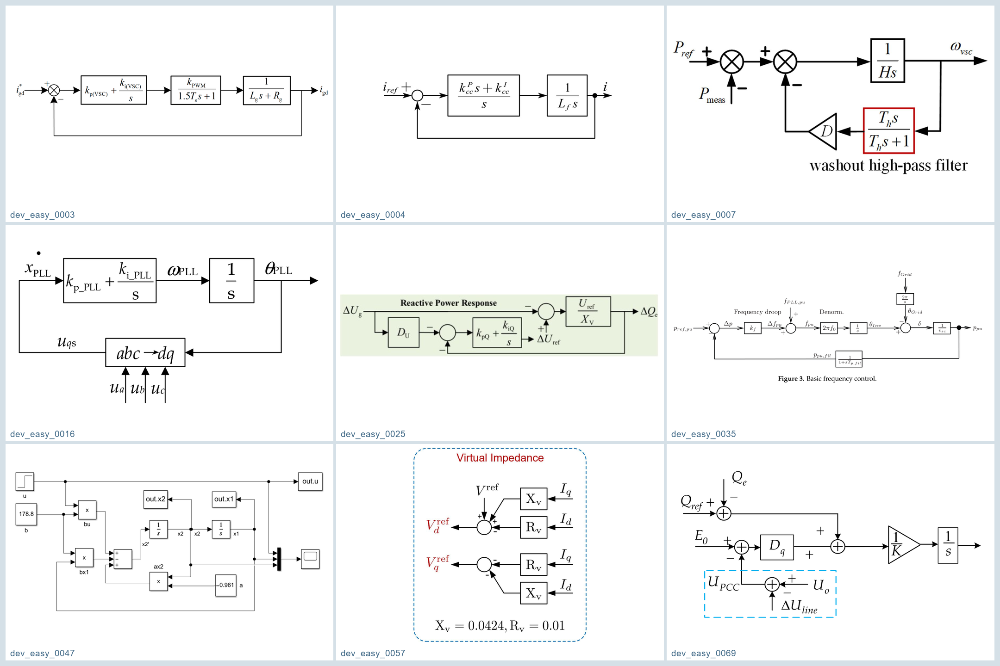
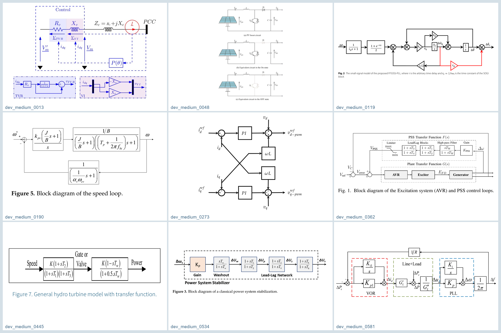
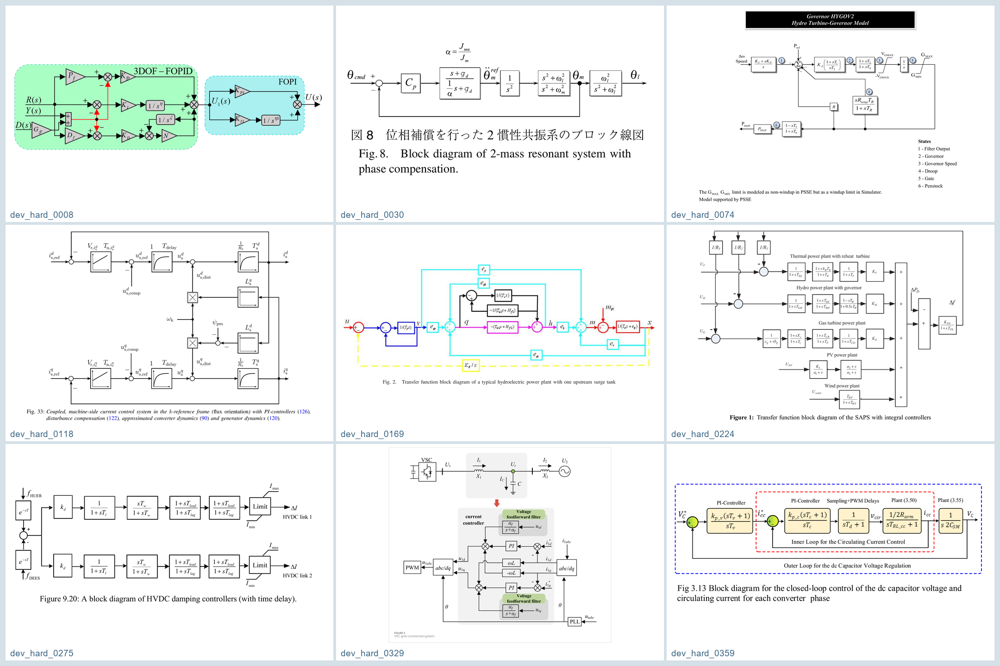
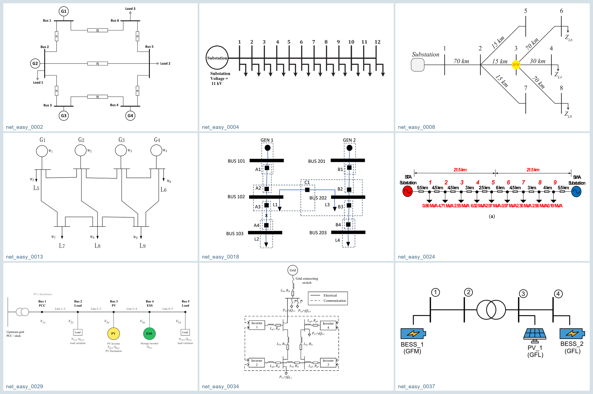
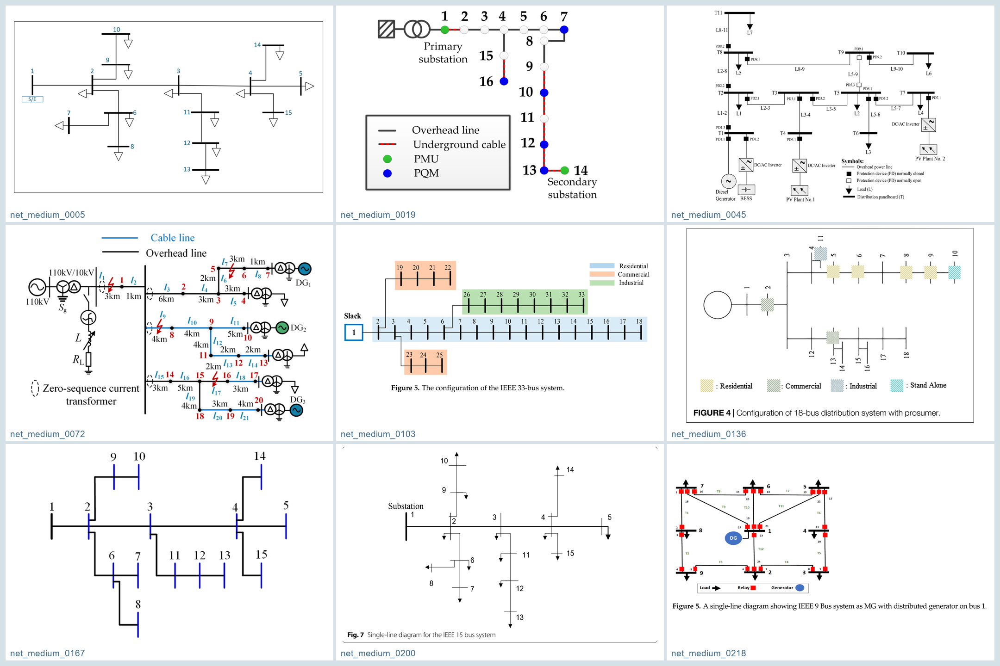
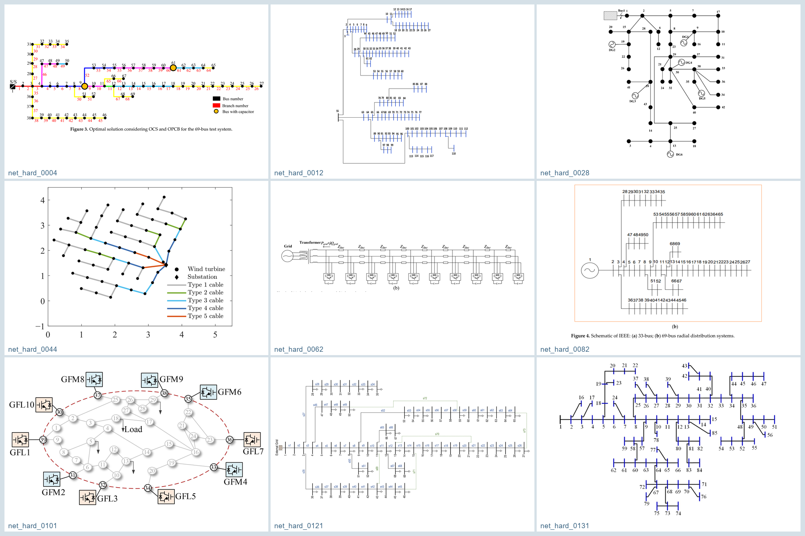

<!-- This README is one language at a time. Other versions are linked below. -->

[English](../../README.md) · [中文](README.zh.md) · [Français](README.fr.md) · [Español](README.es.md) · [Русский](README.ru.md) · **العربية**

<p align="center">
  
</p>

# MINEGRID

### من نماذج أنظمة القدرة إلى الاستدلال متعدد الوسائط

يجمع MINEGRID أوصافًا تفصيلية غير خطية للمعدات، وصورًا مقترنة بتعليقاتها المرجعية، وتعليمات إضافية للشبكات. يمكن استخدام مكتبة النماذج لتطوير محاكي بحثي صغير، واستخدام المعيار متعدد الوسائط لدراسة فهم نماذج الرؤية واللغة لمخططات التحكم والشبكات الكهربائية.

## استكشف المجموعة

- **[المعدات النموذجية](../../Multimodal/Alpaca%20Data/Apparatus/index.html)** — 14 فئة من المعدات · 46 تهيئة · أوصاف HTML
- **[المعيار متعدد الوسائط](../../JSON%20Index/README.md)** — 1,429 زوجًا من الصور والتعليقات · مهمتان · ثلاثة مستويات صعوبة
- **[تعليمات إضافية](../../Multimodal/Alpaca%20Data/README.md)** — تعليمات للشبكات وملف واحد كمثال للمعرفة العامة

## المعدات النموذجية: نطاق النمذجة

تصف كل صفحة متغيرات الحالة والمعلمات والمدخلات والمخرجات والمعادلات التفاضلية والجبرية والحدود غير الخطية وافتراضات النمذجة. تُعرض التهيئات التفصيلية وأنماط التحكم البديلة بصورة مستقلة. ملفات HTML مراجع للنمذجة وليست حزمة محاكاة تنفيذية جاهزة.

| المعدة | نطاق النموذج | التهيئات |
|---|---|---|
| [مولد متزامن تفصيلي](../../Multimodal/Alpaca%20Data/Apparatus/sg.html) | ديناميكيات كهرومغناطيسية لستة ملفات، وحركة الدوار، وحاكم السرعة، والإثارة، وPSS، والتشبع والحدود بحسب التهيئة. | 3 |
| [محوّل مشكّل للشبكة VSG](../../Multimodal/Alpaca%20Data/Apparatus/gfm_vsg.html) | قصور ذاتي افتراضي وتخميد، وتنظيم القدرة والجهد، وحلقات داخلية، ومرشح LCL، ووصلة DC، وحدود ومنع تراكم التكامل. | 4 |
| [تحكم مشكّل للشبكة Droop](../../Multimodal/Alpaca%20Data/Apparatus/gfm_droop.html) | ترشيح القدرة، وتدلي P–f، وتنظيم الجهد والقدرة غير الفعالة، وحلقات داخلية، وLCL وDC، وتهيئات للمركبات المتناظرة. | 3 |
| [تحكم مشكّل للشبكة Matching](../../Multimodal/Alpaca%20Data/Apparatus/gfm_matching.html) | مزامنة بجهد الوصلة المستمرة، وتوازن الطاقة، وتنظيم الجهد والتيار، وديناميكيات المرشح والمشغلات. | 3 |
| [تحكم مشكّل للشبكة dVOC](../../Multimodal/Alpaca%20Data/Apparatus/gfm_dvoc.html) | ديناميكيات سعة المذبذب وطورِه، وتنظيم القدرة، والديناميكيات الكهربائية، والحلقات الداخلية والحدود. | 3 |
| [محوّل تابع للشبكة PQ](../../Multimodal/Alpaca%20Data/Apparatus/gfl_pq.html) | مزامنة PLL، وتحكم بالقدرة الفعالة وغير الفعالة والتيار، وLCL وDC، واجتياز الأعطال واستعادة القدرة. | 4 |
| [محوّل تابع للشبكة PU](../../Multimodal/Alpaca%20Data/Apparatus/gfl_pu.html) | PLL، وتنظيم القدرة الفعالة والجهد المتردد، وحلقات التيار، والديناميكيات الكهربائية ودعم الأعطال. | 4 |
| [توربين رياح DFIG مشكّل للشبكة](../../Multimodal/Alpaca%20Data/Apparatus/gfm_dfig.html) | ديناميكا هوائية، ومنظومة نقل بكتلتين، وفيض الآلة، وتحكم المحوّلات، وDC، وزاوية الريش، وcrowbar/chopper ودعم الأعطال. | 2 |
| [توربين رياح DFIG تابع للشبكة](../../Multimodal/Alpaca%20Data/Apparatus/gfl_dfig.html) | التوربين ونقل الحركة والآلة الحثية، وPLL وتحكم جانبي الدوار والشبكة، وزاوية الريش وcrowbar والتعافي. | 2 |
| [توربين PMSG مباشر مشكّل للشبكة](../../Multimodal/Alpaca%20Data/Apparatus/gfm_pmsg.html) | آلة مغناطيس دائم، وديناميكيات ميكانيكية، ومحوّلان متتاليان ووصلة DC؛ وتحكم VSG أو Matching وزاوية الريش ودعم الأعطال. | 4 |
| [توربين PMSG مباشر تابع للشبكة](../../Multimodal/Alpaca%20Data/Apparatus/gfl_pmsg.html) | تحكم السرعة والتيار على جانب الآلة، وPLL وجهد DC على جانب الشبكة، والديناميكيات الكهرومغناطيسية وزاوية الريش. | 2 |
| [حمل مركز بيانات](../../Multimodal/Alpaca%20Data/Apparatus/data_center.html) | سلسلة تغذية AFE–UPS–VSI–PSU، وحمل حوسبة مكافئ، وديناميكيات القياس والمشغلات وطاقة البطارية الاحتياطية. | 2 |
| [محرك حثي](../../Multimodal/Alpaca%20Data/Apparatus/induction_motor.html) | فيض العضو الثابت والدوار، والسرعة، وعزم الحمل، وقياس الجهد، ومؤشر حراري وحماية انخفاض الجهد. | 2 |
| [محوّل ربط AC/DC](../../Multimodal/Alpaca%20Data/Apparatus/ic.html) | تبادل الطاقة بين AC وDC، وPLL والمرشح وديناميكيات DC؛ وأنماط PQ وEQ وPU وEU وتهيئات للمركبات المتناظرة. | 8 |

[فهرس المعدات](../../Multimodal/Alpaca%20Data/Apparatus/index.html) · [اصطلاحات النماذج](../../Multimodal/Alpaca%20Data/Apparatus/model_conventions.html)

## إحصاءات المعيار متعدد الوسائط

| المهمة | سهل | متوسط | صعب | الإجمالي | دفعات JSONL |
|---|---|---|---|---|---|
| التحكم في المعدات | 76 | 593 | 366 | 1035 | 64 |
| طوبولوجيا الشبكة | 38 | 222 | 134 | 394 | 25 |
| الإجمالي | 114 | 815 | 500 | 1429 | 89 |

الأعداد محسوبة من الملفات الحالية: 1,429 عينة و1,429 صورة مرجعية ضمن 89 دفعة JSONL. مستويات الصعوبة ليست تقسيمات تدريب وتحقق واختبار.

| المجموعة الإضافية | الملفات | سجلات التعليمات |
|---|---|---|
| Network بصيغة JSON | 32000 | 335517 |
| General Knowledge: مثال JSON | 1 | 39 |

لا تدخل التعليمات الإضافية ضمن عدد عينات الصور. يحتوي Apparatus على 16 صفحة HTML، تشمل الفهرس واصطلاحات النماذج؛ ويحتوي General Knowledge على ملف مثال واحد فقط.

## نظرة بصرية عامة

تسعة أمثلة تمثيلية لكل مهمة ومستوى صعوبة ضمن لوحات متراصة من 3 × 3. تُعرض مخططات التحكم في المعدات في صف، وطوبولوجيا الشبكات في الصف التالي، مع مستويات الصعوبة الثلاثة جنبًا إلى جنب. انقر على اللوحة لعرضها بالدقة الكاملة؛ وتُحفظ معرفات العينات لتسهيل تتبعها.

### التحكم في المعدات

| سهل | متوسط | صعب |
|---|---|---|
| [](../assets/apparatus_easy.png) | [](../assets/apparatus_medium.png) | [](../assets/apparatus_hard.png) |

### طوبولوجيا الشبكة

| سهل | متوسط | صعب |
|---|---|---|
| [](../assets/network_easy.png) | [](../assets/network_medium.png) | [](../assets/network_hard.png) |

## بناء محاكي أولي لنظام قدرة صغير

استخدم أوصاف HTML مواصفاتٍ لمحاكي أولي محدود الحجم: واجهة موحدة للمعدات، ووحدات وأطر مرجعية متسقة، وحدود محفوظة، وربط معادلات المعدات بقيود الشبكة، ثم التهيئة والتكامل الزمني ومعالجة الأحداث. يدعم ذلك النماذج البحثية والتنفيذ بمساعدة LLM، مع تحقق هندسي مستقل لاحقًا.

### مواءمة الاستجابة الديناميكية مع PSCAD وPowerFactory

عند الحاجة إلى مواءمة ديناميكية عالية الدقة مع نماذج PSCAD أو PowerFactory أو برامج مماثلة، يمكن استخدام أوصاف TypicalApparatus كنقطة انطلاق لبنية النموذج. توفر الطريقتان الواردتان في [Guo وShi ‏(2024)](https://doi.org/10.1109/CIEEC60922.2024.10583352) و[Shi وGuo وآخرين ‏(2026)](https://doi.org/10.1109/TSTE.2025.3621702) أساسًا لاستخلاص صيغ تحليلية صريحة لمعادلات النموذج من بيانات الحالات العابرة والقيود الفيزيائية، باستخدام تعرّف النماذج والانحدار الرمزي.

ينبغي توحيد الوحدات والأطر المرجعية والشروط الحدّية مع النموذج المرجعي. ثم تُختبر قابلية التعميم عند نقاط تشغيل واضطرابات لم تُستخدم في التعرّف، بمقارنة الاستجابات العابرة الناتجة مع استجابات البرنامج المرجعي. يمكن الرجوع إلى الشيفرة ذات الصلة في [DSIPS — Dynamic Sparse Identification of Power System](https://github.com/gdg1999/DSIPS).

## أمثلة على المطالبات

### 1 · تحويل وصف المعدة إلى مكوّن

```text
استخدم ملف HTML المرفق لنموذج MINEGRID VSG بوصفه المواصفة. عدّد جميع الحالات والمتغيرات الجبرية والمدخلات والمخرجات والمعلمات والوحدات والأطر المرجعية. صمّم واجهات f(x,z,u;p) وg(x,z,u;p) وتيار الحقن في الشبكة. حافظ على جميع الحدود وآليات منع تراكم التكامل. افصل القيم المتاحة عن المعلومات الناقصة ولا تخترع معلمات. قدّم خطة التنفيذ وربط المعادلات بالكود قبل كتابة البرنامج.
```

### 2 · تجميع محاكي ديناميكي أولي

```text
اعتمادًا على أوصاف المولد المتزامن وGFM وGFL والحمل المرفقة، صمّم محاكيًا بحثيًا لشبكة من ثلاث عقد. حدّد القواعد المشتركة ومعادلات الشبكة والواجهات والتهيئة المتسقة. أضف تغيرًا صغيرًا في الحمل وتسجيل الحالات والتيارات والجهود وفحص البواقي وتقارب الخطوة الزمنية. اذكر المعلمات الشبكية والافتراضات الإضافية غير المتاحة في الوثائق. ميّز الوظائف المنفذة عن السلوك غير المتحقق منه.
```

## تقييم نماذج الرؤية واللغة ودراسة آلياتها

- تقييم القدرات: التعرف على كتل التحكم وإشارات التغذية الراجعة والحالات واشتقاق DAE؛ واستخراج العقد والفروع والاتصالات وإعادة بناء جداول الشبكة.
- دراسة الآليات: تجارب مضبوطة للغة المطالبة والدقة والحجب ومواضع الرموز؛ وتصنيف أخطاء الإدراك والاستدلال الفيزيائي؛ وتحليل الانتباه والتنشيط عند إتاحة المعلومات الداخلية للنموذج.
- بروتوكول التقييم: احجب الإجابات المرجعية عن المدخلات، وثبّت توزيع المهام والصعوبة، وقارن البنية والاتساق الفيزيائي، واجمع المصادر المشتركة للحد من تسرب البيانات. المطابقة النصية وحدها لا تكفي للمعادلات المتكافئة.

## بنية الملفات وتنسيق التعليقات

```text
JSON Index/
├── device_control_*/      # JSONL
└── network_topology_*/     # JSONL
Multimodal/
├── Alpaca Data/
│   ├── Apparatus/          # HTML
│   ├── Network/            # JSON
│   └── General Knowledge/  # JSON
├── apparatus_{easy,medium,hard}/
└── network_{easy,medium,hard}/
Scripts/
docs/
├── assets/
└── readme/
```

يتضمن كل سجل JSONL الحقول id وimage وconversations وannotations. تُفسّر مسارات الصور انطلاقًا من جذر المستودع. يجب تحليل قيمة رد المساعد مرة أخرى بصيغة JSON للحصول على الإجابة. المطالبة الأصلية بالصينية، ويوفر annotations اللغات en وes وar وfr وru. لغات README الست لا تعني وجود ست ترجمات مستقلة للإجابات. ملفات JSON الإضافية مصفوفات من سجلات instruction/input/output.

[دليل التعليقات](../../JSON%20Index/README.md) · [دليل التقييم](../../Scripts/LLM%20Evaluation/README.md)

## الاستشهاد العلمي

إذا أسهم هذا المورد في عملك، يُرجى الاستشهاد بالورقة المرتبطة:

D. Guo, S. Li, X. Shi, S. Jiang, G. Konstantinou and Y. Cao, "A Large Language Model-Based Framework for Automated Dynamic Simulation of Power Systems," in *IEEE Transactions on Smart Grid*, doi: [10.1109/TSG.2026.3731592](https://doi.org/10.1109/TSG.2026.3731592).

```bibtex
@article{guo2026automated,
  author  = {Guo, D. and Li, S. and Shi, X. and Jiang, S. and Konstantinou, G. and Cao, Y.},
  title   = {A Large Language Model-Based Framework for Automated Dynamic Simulation of Power Systems},
  journal = {IEEE Transactions on Smart Grid},
  year    = {2026},
  doi     = {10.1109/TSG.2026.3731592}
}
```

طرق ذات صلة لتعرّف النماذج من البيانات العابرة والتجميع المقيّد بالفيزياء:

1. D. Guo and X. Shi, "Model Identification of Grid-following System for Stability Evaluation with Transient Data," *2024 IEEE 7th International Electrical and Energy Conference (CIEEC)*, Harbin, China, 2024, pp. 01–06, doi: [10.1109/CIEEC60922.2024.10583352](https://doi.org/10.1109/CIEEC60922.2024.10583352).

2. X. Shi, D. Guo *et al*., "Physical-Informed Detailed Aggregation of Wind Farm Based on Symbolic Regression: Structure, Solution and Generalizability," in *IEEE Transactions on Sustainable Energy*, vol. 17, no. 2, pp. 1511–1524, April 2026, doi: [10.1109/TSTE.2025.3621702](https://doi.org/10.1109/TSTE.2025.3621702).

```bibtex
@inproceedings{guo2024identification,
  author    = {Guo, D. and Shi, X.},
  title     = {Model Identification of Grid-following System for Stability Evaluation with Transient Data},
  booktitle = {2024 IEEE 7th International Electrical and Energy Conference (CIEEC)},
  address   = {Harbin, China},
  year      = {2024},
  pages     = {01--06},
  doi       = {10.1109/CIEEC60922.2024.10583352}
}

@article{shi2026aggregation,
  author  = {Shi, X. and Guo, D. and others},
  title   = {Physical-Informed Detailed Aggregation of Wind Farm Based on Symbolic Regression: Structure, Solution and Generalizability},
  journal = {IEEE Transactions on Sustainable Energy},
  volume  = {17},
  number  = {2},
  pages   = {1511--1524},
  month   = apr,
  year    = {2026},
  doi     = {10.1109/TSTE.2025.3621702}
}
```

## موقع Minegrid

**موقع Minegrid: قيد الاختبار والصيانة…**
